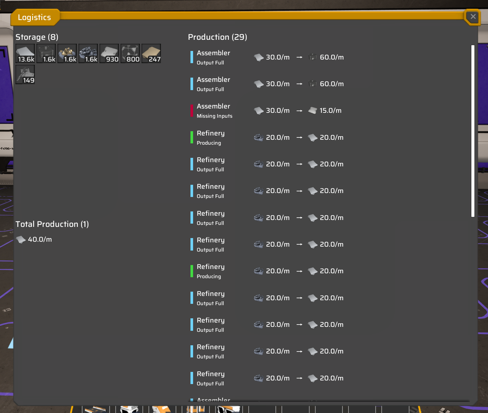

# Elvenide's Logistics Menu

**Elvenide's Logistics Menu** is a station-wide logistics dashboard for **Main Sequence** showing stored items, machine statuses, and live production/consumption rates, built with UE4SS Lua.

It is designed to feel native to the base game—matching its exact UI style—and is **100% save-safe and removable** without adding custom items, machines, or save dependencies.

## Getting Started

- **[Getting Started & Installation Guide](docs/get-started.md)**

## Logistics UI Screen

Inspect your station's total stored inventory and production/consumption throughput at a glance.

*Logistics overview showing aggregated station storage, total production rates, and per-machine status indicators (`Producing`, `Output Full`, and `Missing Inputs`).*

### Opening Logistics

- Press **`L`** (default) while on foot in a space station to toggle the **Logistics** window (press **`Escape`** or click **Close** to close it).
- A **Logistics** keybind indicator also appears in the **top-right HUD** alongside **Power (`P`)** and **Station Map (`N`)** while on foot in a station (automatically collapsing when piloting a ship or outside a station) and updates automatically if you rebind the key.

### Features

- **Live Auto-Refresh**:
  - Automatically refreshes container totals, production/consumption rates, and machine statuses every **`1.5s`** while the window is open.
- **Station Container Storage Grid (Top-Left)**:
  - Aggregates all items currently stored across every container on your station into an inventory-style icon grid, sorted by quantity.
- **Total Production Rates (Bottom-Left)**:
  - 2-column summary showing the combined items/min production rate for every item produced on your station.
- **Production & Consumption Rate Monitor**:
  - Lists every production machine (assemblers, advanced assemblers, refineries, etc.) on the station in an icon-heavy layout.
  - Displays each ingredient's icon and consumption rate (**items/min**) alongside the output item's icon and production rate (**items/min**).
  - **Machine Status Indicator** (4 status colors; hover over any machine row for the exact status tooltip):
    - **Green**: Running normally (`Producing`), with all ingredients supplied.
    - **Blue**: Output buffer is full (`Output Full`).
    - **Amber**: Idle (`No Recipe` or `Idle`).
    - **Red**: Blocked or bottlenecked (`No Power`, `Invalid Config`, `Missing Inputs`, or `Input Deficit`).

### Configuration

- **In-Game**: Open **Settings → Controls** and look for **Logistics** to rebind the key, revert to default (`L`), or clear the binding.
- **Config File**: Stored in `MainSequenceLogisticsMenu/config.json` under `"LogisticsKey"`.

## Credits

**Elvenide's Logistics Menu** is created and maintained by Elvenide. This is an unofficial mod and I'm not affiliated with Main Sequence.

> If you have questions or run into issues, feel free to reach out in #modding-guides within the [official Main Sequence Discord server](https://discord.com/invite/uy8w2pTcQE).
